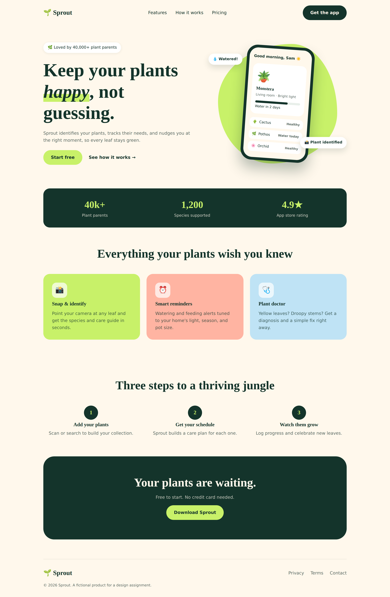

# Sprout – Plant Care App Landing Page

A responsive landing page for **Sprout**, a fictional mobile app that helps people identify plants and keep them healthy with smart care reminders.

## Target Users
Young professionals and students living in apartments who love plants but forget to water them or don't know what each plant needs.

## Design Choices
- **Forest green + lime + cream palette:** natural, fresh, and calm.
- **Fraunces (headings) + Inter (body):** a friendly serif paired with a clean sans-serif.
- **Organic blob and tilted phone mockup:** adds personality and depth to the hero.
- **Pastel feature cards:** lime, coral, and sky make each feature easy to tell apart.
- **Floating chips and hover effects:** small touches of motion without clutter.
- **8px spacing scale** and shared CSS variables keep everything consistent.

## Shared Styles
| Color | Hex |
|---|---|
| Forest | #14342B |
| Cream | #FFF8EC |
| Lime | #C8F169 |
| Coral | #FFB4A2 |
| Sky | #BFE3F5 |
| Muted text | #5B6B64 |

| Typography | Font / Size |
|---|---|
| H1 | Fraunces Bold / 68 |
| H2 | Fraunces Bold / 44 |
| H3 | Fraunces SemiBold / 20 |
| Body | Inter Regular / 16 |

## Reusable Components
1. **Button** (dark, lime, ghost variants)
2. **Feature card** (icon, title, text, color variant)
3. **Phone mockup** with plant card and plant list
4. **Header and footer**

## Page Sections
Header → Hero → Stats strip → Features → How it works → Call to action → Footer

## Responsive Behaviour
- Above 900px: two-column hero, three-column cards and steps
- 900px and below: everything stacks into one column
- 640px and below: nav links hidden, smaller blob

## Run Locally
Open `index.html` in a browser.

## Deploy on GitHub Pages
Push the files, then go to **Settings → Pages**, choose the `main` branch and root folder, and save.

## Files
- `index.html`: structure
- `style.css`: tokens, components, and responsive rules
- `sprout-landing-page.png`: desktop design
- `sprout-landing-page-mobile.png`: mobile view
- `README.md`: documentation
